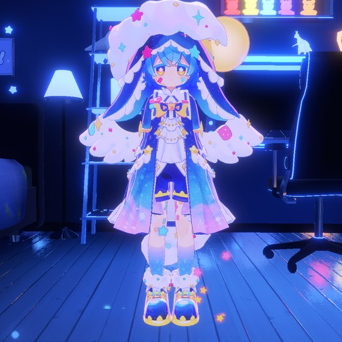
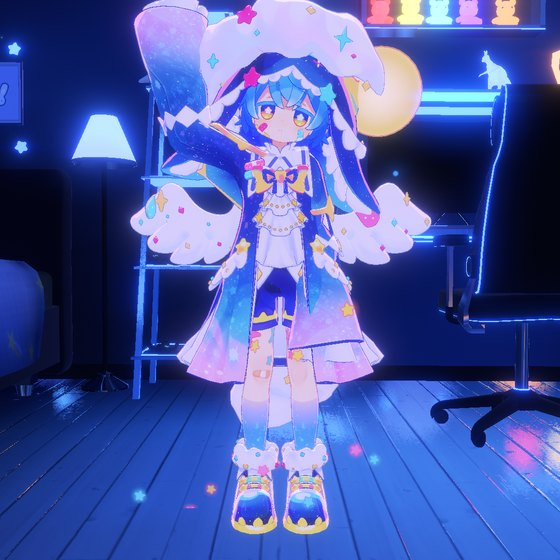
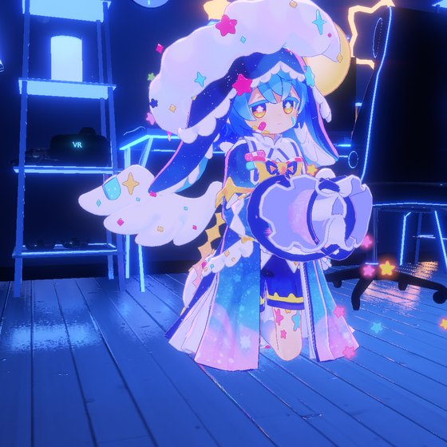
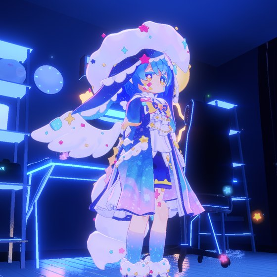
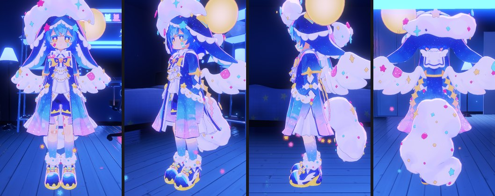
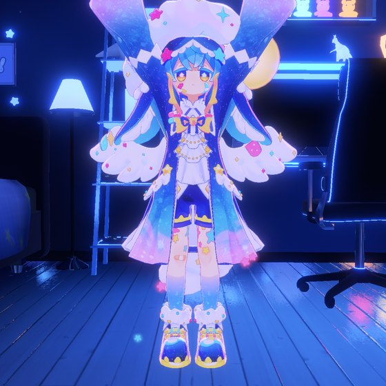
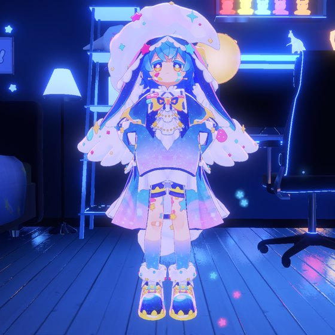
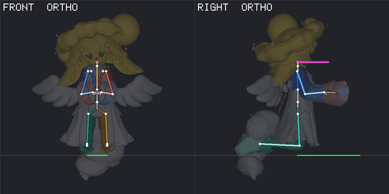
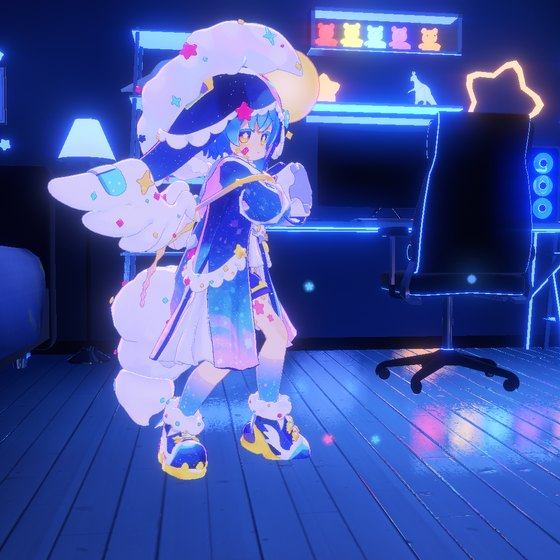
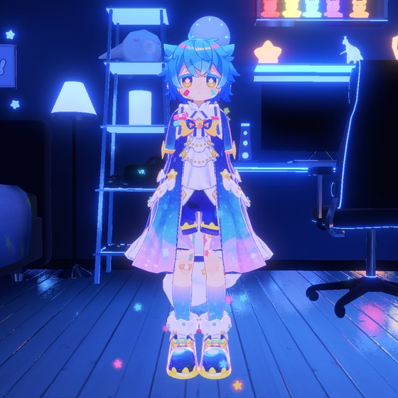

# WARUDO Agent Bridge

**English** | [한국어](README.ko.md) | [日本語](README.ja.md)

**Ask an AI in plain words, and it operates WARUDO for you.**

Send a chat message like "Smile, wave, and take one shot from the front." The AI moves the camera in WARUDO, changes the expression, sets the pose, takes the photo and shows it to you. No coding needed. Installing means pasting one command.

<p>




</p>

<sub>The photos above are all real screenshots of the WARUDO default character (Shipilka) running the requests from the [examples](#what-can-you-do) section through this bridge.</sub>

> Not affiliated with WARUDO or HakuyaLabs. Free (MIT licensed), made by StudioRaming.

## Table of contents

1. [What is MCP? (start here if new)](#what-is-mcp)
2. [What can you do? (examples)](#what-can-you-do)
3. [Requirements](#requirements)
4. [Install (step by step)](#install)
5. [Connect to an AI app](#connect-to-an-ai-app): Claude Desktop, Claude Code, Codex, ChatGPT Desktop
6. [First use](#first-use)
7. [Safe use](#safe-use)
8. [FAQ](#faq)
9. [Troubleshooting](#troubleshooting)
10. [Advanced](#advanced)

## What is MCP?

ChatGPT and Claude can normally **only chat in text**. They cannot click buttons in a program running on your computer.

**MCP** (Model Context Protocol) is a **common spec for giving tools to AI**. Think of USB. The spec is the same everywhere, so it plugs into any AI app.

**WARUDO Agent Bridge** is a set of MCP tools for WARUDO. Once installed, the AI gets 82 tools: "move camera", "change expression", "set pose", "take photo" and more.

```
you (ask in chat)
 ↓
AI app (Claude, Codex, ChatGPT Desktop)
 ↓ MCP
WARUDO Agent Bridge (runs on your PC)
 ↓
WARUDO
```

Good to know:

- **AI app and WARUDO must be running on the same PC.** The bridge passes data to WARUDO only through files on your PC. It opens no internet port.
- **Chat goes to the AI service.** What you send and what the AI reads (scene info, captured photos) are handled by that company's servers like normal chat.
- **The bridge is free.** AI app fees follow each service's pricing.
- **Windows only.** WARUDO is a Windows program.

## What can you do?

Examples of what you send to AI and the result. For each photo, the tools that fit the request were actually run through this bridge on the WARUDO default character (Shipilka). AI replies are shortened. "Tools used" are chosen by AI; you don't need to memorize them.

### 📸 Photos and camera

| 💬 You ask | 🤖 Result |
| --- | --- |
| **"Take a full-body shot from the front."** | <br>"Moved the camera to the front of the character and took a shot."<br><sub>Tools: `warudo_camera_pose` → `warudo_camera_capture`</sub> |
| **"Take a close-up of the face."** | <br>"Read the head bone position and put the camera close to the face."<br><sub>Tools: `warudo_character_pose_get` → `warudo_camera_pose` → `warudo_camera_capture`</sub> |
| **"Take a striking low-angle shot."** | <br>"Shot from knee height, looking up at an angle."<br><sub>Tools: `warudo_camera_pose` → `warudo_camera_capture`</sub> |

**"Take a photo from front, diagonal, side and back. Show me all four."**



"Widened the field of view to 60 degrees and walked around the character taking four shots."<br>
<sub>Tools: `warudo_camera_zoom` → `warudo_camera_pose` → `warudo_camera_capture` (four times; shown as one composite here)</sub>

### 😊 Expressions

Each character has different expression names. The AI reads the character's expression list (blendshapes) first, then picks the ones that fit your request. This character had 106.

| 💬 You ask | 🤖 Result |
| --- | --- |
| **"Make her smile big."** | <br>"Turned on smiling eyes (笑い), happy eyes (にこり), mouth corners (口角上げ), open mouth (あ), and rosy cheeks (照れ)."<br><sub>Tools: `warudo_character_blendshapes` → `warudo_character_blendshape`</sub> |
| **"Wink and stick your tongue out a bit."** | <br>"Turned on wink (ウィンク) and tongue out (てへぺろ)."<br><sub>Tools: `warudo_character_blendshape`</sub> |
| **"Surprised face!"** | <br>"Turned on surprised eyes (びっくり), surprised mouth (口_驚き), and raised eyebrows (上)."<br><sub>Tools: `warudo_character_blendshape`</sub> |
| **"Reset the expression."** | "Cleared all the expressions I changed. Back to the default."<br><sub>Tools: `warudo_character_blendshape` (`clear`)</sub> |

### 🙋 Poses

Poses work by saying which way to aim body parts. The bridge prevents impossible joint angles, and returns the result once the pose actually shows on screen.

| 💬 You ask | 🤖 Result |
| --- | --- |
| **"Make a hand-wave pose."** | <br>"Right arm up to the side, elbow bent. Tilted the head a bit."<br><sub>Tools: `warudo_character_pose_set`</sub> |
| **"Do a banzai pose!"** | <br>"Both arms stretched straight up. Lifted the head a bit."<br><sub>Tools: `warudo_character_pose_set`</sub> |
| **"Hands on hips, confident stance."** | <br>"Elbows out, hands on hips. Chest out, chin up a bit."<br><sub>Tools: `warudo_character_pose_set`</sub> |
| **"Kneel and clasp your hands together."** | <br>"Lowered hips to 33.5cm above ground. Shins on the floor. Hands together in front."<br><sub>Tools: `warudo_character_pose_set` (`hipsHeight`)</sub> |

**"Check if the pose is right. Is the foot sinking into the floor?"**



"Drew the skeleton without clothes and background from front and side. Knees and feet touch the floor. The shoe tips sink about 0.5cm. The tail ornament reaches 18cm below the floor, so in this sitting pose it will look buried."<br>
<sub>Tools: `warudo_analysis_capture` (WARUDO screen does not change)</sub>

| 💬 You ask | 🤖 Result |
| --- | --- |
| **"Save this pose as a .anim file for Unity."** | "`Kneel_Readme.anim` (70KB) saved. You can use it as a humanoid animation in a Unity project."<br><sub>Tools: `warudo_character_pose_save`</sub> |
| **"Release the pose and return to the default idle."** | "Released the pose and switched back to the default idle animation (AGIA_Idle_generic_01)."<br><sub>Tools: `warudo_character_pose_clear`</sub> |

### 💃 Animations and outfits

| 💬 You ask | 🤖 Result |
| --- | --- |
| **"Dance happily."** | <br>"Set the default WARUDO dance 'High Rhythm Dance 01' as the idle animation."<br><sub>Tools: `warudo_resource_list` → `warudo_character_animation`</sub> |
| **"Take off the hat and wings."** | <br>"Found the hat (HeadItem_Hat, HeadItem_Halo) and wings (Item_Wing, Item_SmallWing) objects in the character and turned them off."<br><sub>Tools: `warudo_hierarchy_list` → `warudo_object_active`</sub> |

### 🔎 Scene inspection and undo

| 💬 You ask | 🤖 Result |
| --- | --- |
| **"Is the bridge connected?"** | "Yes. Version 0.2.0 is running inside WARUDO, and I checked the open scene name."<br><sub>Tools: `warudo_status`</sub> |
| **"What's in the scene?"** | "One camera, an environment, a directional light, one character (Shipilka), an FPS counter, and a beginner setup helper."<br><sub>Tools: `warudo_scene_get`</sub> |
| **"What blueprints are there?"** | "Two blueprints named 'New Blueprint' are on, and both are empty (no nodes)."<br><sub>Tools: `warudo_blueprint_list`</sub> |
| **"I'm going to experiment, so save the current state first."** | "Made a recovery snapshot. Did not touch the scene file. Tell me if you want to undo."<br><sub>Tools: `warudo_scene_snapshot` (undo with `warudo_scene_restore`)</sub> |

### 💡 More requests like these

| Request | Tools AI uses |
| --- | --- |
| "Move the character 1 meter to the right and turn her to face the camera." | `warudo_asset_transform` |
| "Change the light to orange like sunset and make it a bit brighter." | `warudo_asset_fields` → `warudo_asset_patch` |
| "Switch to a different background. Show me what's available first." | `warudo_resource_list` → `warudo_asset_source` → `warudo_asset_wait_loaded` |
| "Play the hand-wave animation once." | `warudo_character_animation` (`oneShot`) |
| "Stretch the right hand toward this prop so it touches." | `warudo_character_ik_set` |
| "Pose like this photo." (attach photo) | `warudo_analysis_capture` → `warudo_character_pose_set` (repeat) |
| "Turn off all clothes and show just the body. Put them back when done." | `warudo_hierarchy_list` → `warudo_object_active` |
| "Take a full WARUDO screen capture with the UI." | `warudo_screen_capture` |
| "It looks like there was an error. Check the WARUDO log and find the cause." | `warudo_runtime_logs` |
| "Save the current scene as 'stream_test'." | `warudo_scene_save_as` |
| "Show the scene list and open the one I used yesterday." | `warudo_scene_list` → `warudo_scene_open` |
| "Change this node value in the blueprint." | `warudo_blueprint_get` → `warudo_node_patch` |
| "Click the Apply button in WARUDO's panel while I keep working in another window." | `warudo_ui_list` → `warudo_ui_click` |

All 82 tools are in [docs/TOOLS.md](docs/TOOLS.md).

**Tips for good requests**

- If you want to see the result, add **"and show me a photo"** at the end. The AI takes a photo and shows it in the chat.
- If you don't like it, just ask to adjust. "Raise the arm a bit higher", "move the camera a bit left".
- You can make multiple requests at once. "Smile, wave your hand, and take a photo from the front."
- When done, **"put it back to normal"** resets the expression, pose and camera in one request.

## Requirements

| What | Notes |
| --- | --- |
| Windows 10 or 11 PC | |
| [WARUDO](https://store.steampowered.com/app/2079120/WARUDO/) (Steam) | No mod install needed. The bridge runs as a WARUDO Playground script. |
| One AI app | Claude Desktop, Claude Code, Codex, ChatGPT Desktop, or Cursor. See [Connect to an AI app](#connect-to-an-ai-app). |
| Node.js 20 or newer | You don't need to know what this is. If it is missing, the installer offers to install it. |

**Install the AI app and run it once first,** then install the bridge. The installer finds AI apps on this PC and connects automatically.

## Install

### Step 1: Open PowerShell

- **Windows 11**: Right-click the Start button (Windows logo) at the bottom → **Terminal**
- **Windows 10**: Right-click the Start button → **Windows PowerShell**

A black (or blue) window appears. No admin access needed.

### Step 2: Paste the install command

Copy the line below, paste it into the PowerShell window (`Ctrl+V` or right-click), and press `Enter`.

```powershell
irm https://raw.githubusercontent.com/StudioRaming/warudo-agent-bridge/main/install.ps1 | iex
```

This downloads and runs [install.ps1](install.ps1) from this repo. Open the link first if you want to see what it does.

### Step 3: Answer questions if they appear

If Node.js is missing, it asks:

```
Install Node.js LTS now with winget? [Y/n]
```

Type `Y` and press `Enter`. Windows asks "Do you want to allow this app to make changes to your device?" Click **Yes**. If it says "Open a new PowerShell window and run the installer again", close this window and open a new one, then redo step 2.

### Step 4: Check the result

When done, you see (line count varies by which AI apps were found):

```
WARUDO Agent Bridge 0.2.0
  home:     C:\Users\YOU\.warudo-agent-bridge
  runtime:  C:\...\Warudo\Warudo_Data\StreamingAssets\Playground\WarudoAgentBridge\WarudoAgentBridge.cs
  claude-code     registered (user scope)
  codex           registered
  claude-desktop  registered Restart Claude Desktop to load it.

Next: start WARUDO. A running WARUDO loads the new bridge by itself once Playground recompiles (up to about 30 seconds).
Open a new agent session and ask it to call warudo_status. Check anything odd with: warudo-agent-bridge doctor
```

- `runtime:` means the bridge file was placed in WARUDO.
- `registered` means the AI app's connection is set up. If your app is not listed, see [Connect to an AI app](#connect-to-an-ai-app).
- Config files that get changed are backed up first to `%USERPROFILE%\.warudo-agent-bridge\backups`.

### Step 5: Restart WARUDO and the AI app

1. Start WARUDO. If it was already running, **wait about 30 seconds.** WARUDO loads the new file automatically.
2. **Fully close** the AI app (just closing the window may leave it running in the background. Also close it from the system tray at the bottom right).

Now go to [First use](#first-use).

## Connect to an AI app

The installer already registered apps it found. Below is **how to verify** and **what to do if it did not work**.

### Claude Desktop

- Auto-register location: `%APPDATA%\Claude\claude_desktop_config.json`
- Verify: Fully close the app and reopen it. Click the **+** button at the bottom left of the chat box → **Connectors** → **Manage connectors**. If `warudo-agent-bridge` appears, it is connected. You can also see it in Settings **Developer** tab. When the AI tries to use tools, it asks for permission.
- If connection fails, check `%APPDATA%\Claude\logs\mcp-server-warudo-agent-bridge.log` for why.
- If the install result did not show `claude-desktop`: run the app once, then run this in PowerShell:

```powershell
npx --yes @studioraming/warudo-agent-bridge@latest install --clients claude-desktop
```

### Claude Code

- Auto-register: `claude mcp add -s user ...` (registers for user scope, works in any folder)
- Verify: Run `claude mcp list` in a new terminal, or type `/mcp` inside Claude Code.
- If the install showed `manual`: the `claude` command was not found. Run the `run:` command that came with the result.

### Codex (CLI, IDE extension)

- Auto-register location: `%USERPROFILE%\.codex\config.toml`
  (also adds `tool_timeout_sec = 180` to prevent long captures from timing out)
- Verify: Run `codex mcp list` or type `/mcp` inside Codex.
- If the install did not show `codex`:

```powershell
npx --yes @studioraming/warudo-agent-bridge@latest install --clients codex
```

### ChatGPT

- **ChatGPT web and mobile app general chat cannot use this.** General chat can only connect to MCP servers on the internet (HTTPS), but this bridge runs only on your PC.
- **ChatGPT Desktop app (Windows) can use this.** The desktop app shares the same config file with Codex CLI and IDE extension (`%USERPROFILE%\.codex\config.toml`), and the installer registers the bridge there.
  1. Install and log into ChatGPT Desktop.
  2. Run the `--clients codex` command from the Codex section above (skip if the install already showed `codex`).
  3. In the app, go to **Settings → MCP servers** and check if `warudo-agent-bridge` appears. If it does, click **Restart**.
  4. Type `/mcp` in the input box to see the connected servers.
- Menu names and available plans may change. As of September 2026, this follows OpenAI docs ([MCP setup](https://learn.chatgpt.com/docs/extend/mcp?surface=app)).

### Cursor and other apps

Cursor auto-registers to `%USERPROFILE%\.cursor\mcp.json`. Other MCP apps: see [Manual registration](#manual-registration).

## First use

1. **Open WARUDO** with a scene that has a character.
2. **Open a new chat** in your AI app. (A chat opened before install may not show tools.)
3. Send this:

   > Check whether WARUDO is connected, using warudo_status.

   If the reply says it is connected and shows the WARUDO version and the open scene name, it worked.
4. If the **AI app asks whether it may use a tool**, read what it wants to do and allow it.
5. Now try the examples from [What can you do?](#what-can-you-do) one by one. Start with "Take a photo of the character from the front" because you see the result right away.

## Safe use

- **Save important scenes first.** Or ask "make a snapshot of the current state first". The bridge also saves a recovery snapshot before opening scenes, restoring snapshots, or deleting assets. It keeps old files when overwriting saved scenes.
- **Be careful during streaming.** Changes the AI makes show up in WARUDO right away. Do a test run before a real stream.
- **Only one AI can change WARUDO at a time.** A second AI gets a "busy" reply instead of fighting over the scene.
- **Results are honest.** If WARUDO closes mid-operation, you get "not run" or "check state". Changes with uncertain results do not auto-retry.
- **Unity script calls are off by default.** Only methods you allow in the config file can be called.

## FAQ

**Do I have to pay?**\
The bridge is free. AI app costs follow each service's pricing.

**Do I need to know coding?**\
No. Just paste one command line at install. After that, ask by chat.

**Do I need to install a WARUDO mod?**\
No. The installer just drops one script file in WARUDO's Playground folder.

**Does it work with my character?**\
Yes. Pose tools work on any humanoid avatar or VRM. Expression names vary by character, but the AI reads the list first and picks the right ones.

**Can I ask in my own language?**\
Yes. Any language the AI app understands. Tool names are English but your requests can be in any language.

**Does it work on Mac?**\
No. WARUDO is Windows only, so the bridge is too.

**Can I undo what the AI changed?**\
Expression, pose, and camera: just say "put it back to normal". For the whole scene, use a snapshot you made first.

**How do I update?**\
Run the install command from [Step 2](#step-2-paste-the-install-command) again. It upgrades to the latest version.

## Troubleshooting

| Symptom | Solution |
| --- | --- |
| AI says "bridge is down" or "cannot connect" | Start WARUDO, wait 30 seconds, then ask again. If it still fails, run `doctor` below. |
| AI app does not show tools | Fully close the AI app (including system tray), reopen, and open a **new chat**. If the install result did not show the app name, run the command from [Connect to an AI app](#connect-to-an-ai-app). |
| `The term 'npx' is not recognized ...` (or `'node'`) | If you just installed Node.js, close PowerShell and open a new window, then try again. |
| `runtime: warudo-not-found` | Steam library is in a different location. Tell the installer where `Warudo.exe` is: `npx --yes @studioraming/warudo-agent-bridge@latest install --warudo "D:\SteamLibrary\steamapps\common\Warudo"` |
| `runtime: NOT installed yet` | The installer found many old-version files and did not replace them while WARUDO is running. Close WARUDO and run install again. |
| Codex capture times out | Run install again to add `tool_timeout_sec = 180` to the config. |

To check everything at once:

```powershell
npx --yes @studioraming/warudo-agent-bridge@latest doctor
```

Any line that says `FAIL` is the problem (`INFO` lines are only information). If you still cannot fix it, copy that output and open an [issue](https://github.com/StudioRaming/warudo-agent-bridge/issues).

## Advanced

### Install options

- `--clients claude-code,codex` (or `none`): pick which AI apps to register.
- `--warudo "D:\...\Warudo"`: tell the installer where WARUDO is if Steam lookup fails.
- `--skip-runtime`: only register AI apps, do not touch WARUDO.

To add options to the one-line install, set an environment variable first:

```powershell
$env:WARUDO_AGENT_BRIDGE_CLIENTS = "claude-code,codex"; irm https://raw.githubusercontent.com/StudioRaming/warudo-agent-bridge/main/install.ps1 | iex
```

### Manual registration

The installer prints the exact command for your machine. For Claude Code it looks like this:

```bash
claude mcp add -s user warudo-agent-bridge -- node "C:\Users\YOU\.warudo-agent-bridge\app\bin\warudo-agent-bridge.mjs" mcp
```

JSON clients use `{"mcpServers": {"warudo-agent-bridge": {"command": "node", "args": ["C:\\Users\\YOU\\.warudo-agent-bridge\\app\\bin\\warudo-agent-bridge.mjs", "mcp"]}}}`.

### How it works

```
AI client ──stdio──> MCP server (Node) ──files──> runtime inside WARUDO (Playground C#)
                     %USERPROFILE%\.warudo-agent-bridge\runtime
```

- **No network.** Requests and replies are files in your user folder. Nothing listens on a port.
- **One writer at a time.** Tools that change WARUDO need a short write lease. The MCP server takes it for you; a second agent gets a clear "busy" reply instead of fighting over the scene.
- **Honest results.** A request is claimed before it runs. If WARUDO closes or reloads the bridge, the reply says `NOT_EXECUTED` (safe to send again) or `UNKNOWN` (check state). Reads and absolute-value writes retry once across a reload on their own.
- **Undo paths.** Opening a scene, restoring a snapshot, and deleting an asset save a recovery snapshot first. Overwriting a saved scene keeps the old file.

### Character pose

Pose tools use Unity humanoid terms, so they fit any humanoid avatar or VRM.

- `warudo_character_pose_set` takes bone aims (`{"LeftUpperArm": {"aim": [-1, -0.2, 0]}}`, x right, y up, z forward) and/or muscles, applied parent-first down the hierarchy. `base: "standing"` starts from the avatar's rest pose; `hipsHeight` sets the hips in meters (adult body standing on knees is about 0.35).
- Joints stay inside the avatar's range. When an aim asks for more, the reply lists it under `limited` so the agent can ease that aim.
- The reply comes once the character shows the pose (`shown`), so a capture right after is correct.
- `warudo_analysis_capture` renders the body without materials or background, colored by body part, from several views at once, and reports hand contacts, how high each body part is above the floor, and where every joint lands in the camera frame. Agents use it to check a pose against a reference image instead of guessing from a shaded screenshot.
- `warudo_character_shot` takes a picture of the character from an orbit around it (named views relative to its facing, framings from full body to face, one contact sheet of up to 6), with a temporary camera that copies the main camera's rendering, so the user's camera never moves. Every view reports where the character is in the frame, how much of the frame it covers and how much of it is hidden behind something else. A Character asset in the scene never gives "no character": the error says whether it is not loaded, disabled or has nothing to render. Use it instead of `warudo_camera_capture` for any picture of the character.
- `warudo_render_pass` draws flat diagnostic passes (parts, albedo, texture, alpha, normals, depth, uv, lighting, overlap) of the live renderers from several viewpoints in one labeled image, with a legend of every material slot: renderer path, slot, material, shader, cutout mode, the texture it really uses (a plugin recolor in a MaterialPropertyBlock wins over the material), tiling and camera-frame bounds. Nothing in WARUDO changes. `passes x views` is at most 12 panels; `texture` needs `textureProperty`.
- `warudo_render_isolate` shows the real look of chosen renderers (`objectIds` from `warudo_hierarchy_list`, or `include` path substrings): `highlight` keeps the frame and dims everything else, `only` shows just them on a neutral, checker or transparent background. It returns each part's screen bounds, visible share and mean sRGB color. A temporary camera copies the main camera; the chosen renderers move to an unused layer for a few synchronous renders and are restored in the same call.
- `warudo_character_pose_save` writes the pose as a Unity humanoid `.anim`, into WARUDO's own animation list or to any folder (for example a Unity project).
- `warudo_character_pose_clear` puts the previous idle animation back.

### Virtual pointer (no focus needed)

An agent can click, double click, drag, hover and scroll inside WARUDO's main window while WARUDO is in the background. The bridge plays a short frame-by-frame mouse timeline into Unity's UI input module, and tells the UI that the window has focus for the time it plays. No Windows mouse or keyboard event is sent, WARUDO is not brought to the front, and your real mouse is not moved.

- **What it reaches:** the main-window UI (UGUI: buttons, sliders, toggles, scroll areas, panels), and plugins that follow the contract below.
- **What it does not reach:** the WARUDO camera (it reads the real mouse; use the camera tools), the WARUDO editor window (another window), and any plugin that reads `Input.mousePosition` or `Input.GetKey` directly.
- **Typical use:** `warudo_ui_list` (what can be clicked, with rectangles) → `warudo_ui_click` by label, or `warudo_pointer_click` / `warudo_pointer_drag` / `warudo_pointer_wheel` at a point. `capture: true` returns a screenshot taken with the pointer still in place. `warudo_ui_at` shows what covers a point; a click aimed at a covered control stops with `COVERED` instead of hitting what is on top. `warudo_ui_set_text` fills input fields, because typed text cannot be sent. `warudo_pointer_state` shows what is held, `warudo_pointer_release` ends everything.
- **Safety:** a gesture is at most 600 frames and 64 points. A button left down (several-call drags) or a parked pointer ends when released, when the write lease ends, or after `pointer.idleReleaseMs` of no use. If you click inside WARUDO while it plays, the gesture stops with `USER_INPUT` and the real mouse is yours again. Turn it all off with `pointer.enabled: false`.
- **Needs this version of the runtime.** An older installed runtime answers `RUNTIME_OUTDATED`: reinstall and let WARUDO recompile Playground.

**Plugin contract (to let a WARUDO plugin see the virtual pointer):**

```csharp
var module = EventSystem.current?.currentInputModule;
var input = module?.input;                        // a BaseInput; the bridge swaps it while a gesture plays
bool virtualInput = module?.inputOverride != null; // treat as focused: do not require Application.isFocused
// Mouse: input.mousePosition (bottom-left origin), input.GetMouseButton/Down/Up(0..2), input.mouseScrollDelta. Not UnityEngine.Input.
// Keys and modifiers: input has public bool GetKey/GetKeyDown/GetKeyUp(KeyCode) when virtual; find them by name (reflection or dynamic).
// Otherwise (inputOverride == null) read the real UnityEngine.Input as before.
```

### Captures that are easy to read

Screenshots are for agents, so each tool makes one kind of information easy to tell apart. Every image tool returns the PNG, its numbers as text, and an `imageId` with a mapping (which window area the image shows and how it was scaled).

- `warudo_screen_capture`: the window, fitted to `maxSize` (default 1600). `region` [x, y, w, h] or `around` { objectId | path } (a UI object, plugin overlay panels included, or a renderer) crops at full resolution first, so small text stays readable. `grid` overlays a coordinate grid labeled in window pixels.
- `warudo_ui_capture`: the same screenshot with a numbered box over every control `warudo_ui_list` returns, colored by kind (button, toggle, slider, input, scroll), plus the legend as text. `warudo_ui_click` then takes `mark` (the number; refused with `MARK_STALE` if the controls changed) or `near` (the visible text, exact first, then contains).
- Gesture captures (`capture: true` on any pointer tool or `warudo_ui_click`): the pointer is drawn on the image (press, release, drag path; `markPointer`). `captureBefore: true` returns BEFORE and AFTER side by side in one PNG, with the changed regions boxed on AFTER and the diff numbers.
- `warudo_screen_diff`: the window now against an earlier capture (`baseline` = the path a capture tool returned): unchanged pixels greyed, changed pixels in color, boxes numbered, mean color before and after per box.
- `warudo_screen_probe`: text only. Mean, median, HSV, luminance, min and max RGB at points and regions, for comparing colors without reading pixels off a picture.
- `warudo_screen_sequence`: 2 to 16 frames, one every K rendered frames, as one numbered contact sheet, with how much each frame changed from the one before (hover, animation and flicker checks).
- **Click where you see it.** Pass `space: "image"` (and optionally `imageId`; default the latest image of this MCP server, which keeps the last 32) to a pointer tool, `warudo_ui_at`, or the `region`/`points` of a capture tool, and x/y are pixels of the image you were shown. The server converts them to window pixels; points outside the image, outside the AFTER panel of a before/after sheet, or on a contact sheet are refused.
- **Needs this version of the runtime** (feature `capture-tools`). `npm run check:pixels` runs the pixel math (crop, downscale, diff boxes, color statistics) under plain .NET with a UnityEngine stub; it needs the same .NET SDK and WARUDO files as `npm run check:runtime`.

### Configuration

`%USERPROFILE%\.warudo-agent-bridge\config.json` (created from [config.example.json](config.example.json)):

- `pointer`: `enabled` (default `true`) turns the virtual pointer and `warudo_ui_set_text` on or off; `idleReleaseMs` (default 15000, 1000..600000) is how long a parked pointer or held button waits for the next call before it is released.
- `componentCall.allow`: Unity component methods the agent may call, as `{"typePrefix": "My.Namespace.", "methods": ["Refresh"]}` entries. Empty by default, so `warudo_component_call` is off.
- `retention`: how long replies, captures, snapshots and pose previews are kept before `warudo_maintenance_cleanup` removes them.

### Command line

The same operations are available without an AI client:

```bash
npx @studioraming/warudo-agent-bridge status
npx @studioraming/warudo-agent-bridge call scene.get
npx @studioraming/warudo-agent-bridge tools
```

After install, `%USERPROFILE%\.warudo-agent-bridge\bin\warudo-agent.cmd` is a shortcut to the same CLI.

### Uninstall

```bash
npx @studioraming/warudo-agent-bridge uninstall
```

This removes the runtime from WARUDO's Playground (restart WARUDO to unload it) and the MCP entries from the clients, with backups. Add `--purge` to also delete `%USERPROFILE%\.warudo-agent-bridge` except its `backups` folder.

### Development

See [CONTRIBUTING.md](CONTRIBUTING.md). Security reports: [SECURITY.md](SECURITY.md).

## License

[MIT](LICENSE) © StudioRaming
